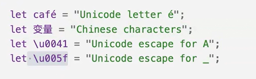
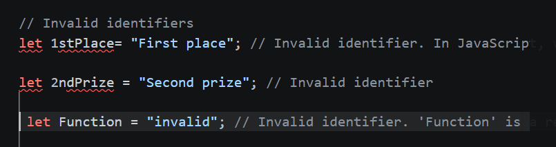

## Valid Idendtifiers ##

## Invalid Identifiers ##

Here Function is a Key word

var First Name = "John";   // Space is not allowed

var 1OneFirst ="Apple"; 

This Invalid identifier.  In JavaScript, variable names cannot start with a digit. Therefore, '1OneFirst' is not a valid identifier.

## Commnets ##

### Single line commnets ###
 
// This is cool code

### Multi line comments ###

/*

This is a multi line comment.

It can span multiple lines.

*/

### Documentation comments ###

/**
 * This is a documentation comment.  
 * Author : David  
 * Date : 10/10/2026   

**/

 Short cut for comments

 Single line comment: Ctrl + /
 
 Multi line comment: Shift + Alt + A

 ### 1. What is an Identifier in JavaScript? ###

 Answer: An identifier is the name used to identify variables, functions, classes, objects, and other entities in JavaScript.

 ### 2. What are the rules for naming identifiers in JavaScript? ###

 Answer:  

✅ Can contain:  

Letters (A-Z, a-z)  
Digits (0-9)  
Underscore (_)  
Dollar sign ($)  

✅ Must start with:  

Letter  
Underscore (_)  
Dollar sign ($)  

❌ Cannot start with a digit.  

Examples:  

JavaScript  
let empName; // Valid  
let _count; // Valid  
let $price; // Valid  
let emp123; // Valid  
 
let 123emp; // Invalid  

### 3. Are JavaScript identifiers case-sensitive? ###  

Answer: Yes, JavaScript identifiers are case-sensitive.  
 
JavaScript  
let age = 25;  
let Age = 30;  
let AGE = 35;  

These are three different identifiers.  

### 4. Can JavaScript identifiers be reserved keywords? ###

Answer: No.  

The following are invalid:  

JavaScript  
let class = "Test"; // Invalid  
let function = "Hello"; // Invalid  
let var = 100; // Invalid  

Reserved keywords include:  

Plain Text  
var, let, const, class, function,  
if, else, for, while, switch, return  

### 5. Which of the following are valid identifiers? ###  
JavaScript  
let studentName; // Valid  
let _student; // Valid  
let $student; // Valid  
let student123; // Valid  
let 123student; // Invalid  
let student-name; // Invalid  

Reason:  

Hyphen (-) is not allowed.  
Cannot begin with a number.  

### 6. Can identifiers contain Unicode characters? ###  

Answer: Yes.  

JavaScript  
let café = "Coffee";  
let नमस्ते = "Hello";  

These are valid identifiers.  

### 7. What is the difference between an Identifier and a Variable? ###  

Answer:  

Identifier	VariableName given to an entity	Storage location for data
Can represent variable, function, class, object	Stores values  

Example: calculateSum	Example: total = 100

### 8.What naming conventions are commonly followed for identifiers? ###  

Answer:  

Variables and Functions: camelCase  

JavaScript  
let employeeName;  
function calculateTotal() {}  

Classes: PascalCase  

JavaScript  
class EmployeeDetails {}  

Constants: UPPER_CASE  

JavaScript  
const MAX_USERS = 100;  
``  
### 9. What is wrong with the following identifiers? ###  
JavaScript  
let first-name = "John";  
let 1price = 100;  
``  

Answer:  

JavaScript  
let firstName = "John";  
let price1 = 100;  
``  

Reasons:  

Hyphen is not allowed.  
Identifier cannot start with a number.  

### 10. Is $ a valid JavaScript identifier? ###  

Answer: Yes.  

JavaScript  
let $ = 100;  
console.log($);  

Output:  

Plain Text  
100  
 
Many libraries like jQuery use $.  

### 11. Is _ a valid JavaScript identifier? ###   

Answer: Yes.  

JavaScript  
let _ = "test";  
console.log(_);  

Output:  

Plain Text  
test  

### 12 What will happen? ###  
JavaScript  
let let = 10;  
``  

Answer: Syntax Error because let is a reserved keyword.  

### 13. Which of these are valid? ###  
JavaScript  
userName // ✅  
_userName // ✅  
$userName // ✅  
user123 // ✅  
123user // ❌  
user-name // ❌  

### 14. Quick Interview One-Liners  
Identifier = Name of variable, function, class, etc.  
Cannot start with a number.  
Can start with _ or $.  
Case-sensitive.  
Cannot use reserved keywords.  
Supports Unicode characters.  
Follows camelCase naming convention for variables/functions.  