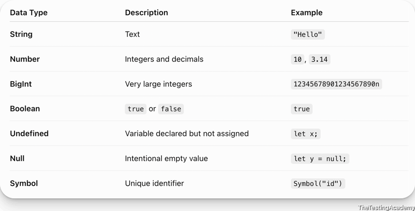
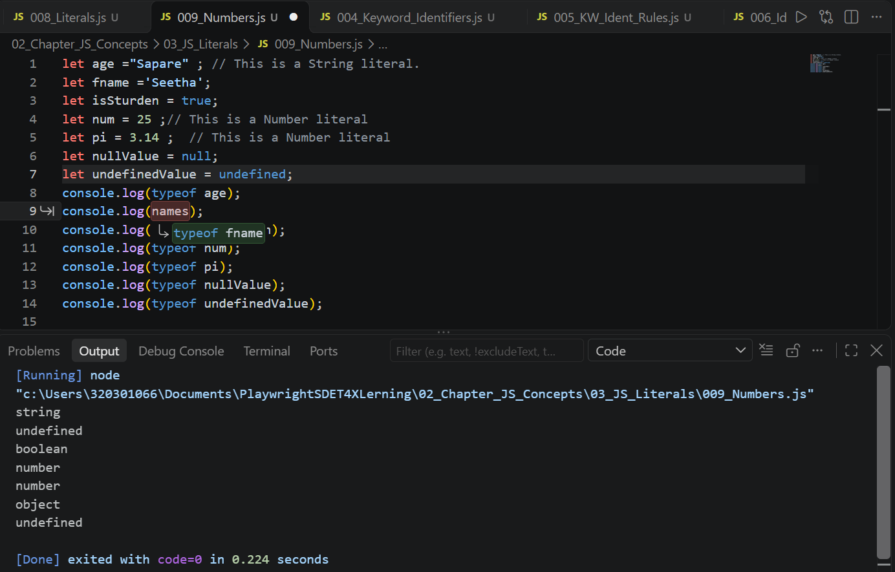
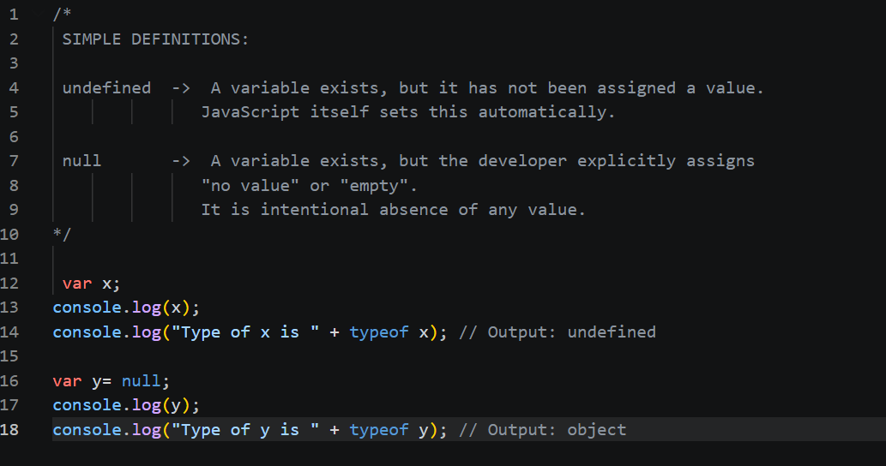
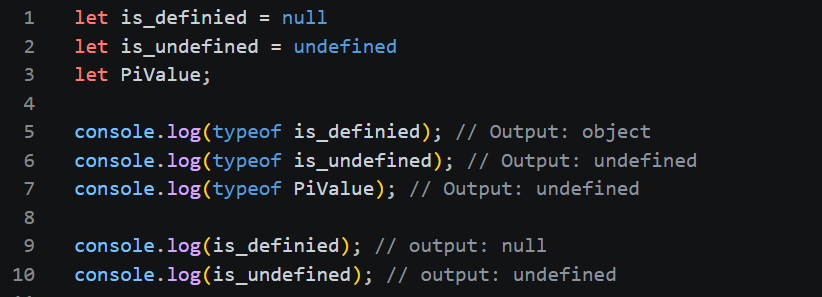
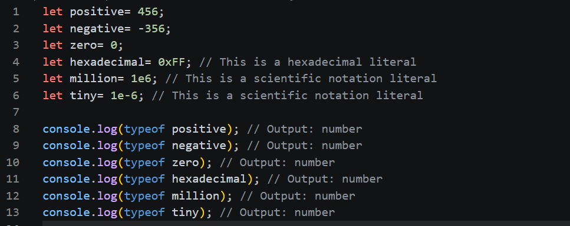

#  **What is a Literal**
let a = 10;

Variable value is as the literal.  the value that you assign directly to a variable is called the literal.

- Number Literals
- Strings
- Boolean
- Null & Special Values
- Objects
- Arrays
- BigInt 
- Reg Expression( Regex)

Which of these is NOT a literal in JavaScript?

- <u>true</u>
- <u>"undefined" (with the quotes)</u>
- <u>null</u>
- **<u>undefined</u>**

-- undefined is not literal part.  -> undefined is a read-only property

What does console.log(0b1010 + 0o10 + 0xA) print? ( 10,8, 10)

- **28**
- NaN
- 0b10100o100xA
- 30

**What does console.log([1, , 3, ].length) print?**

- 2
- **3**
- SyntaxError
- 4

> Tricky one. Count the slots, not the values. The correct answer is 3.

## **Primitive Data Types**

primitive means they cannot be broken down further 

 

 # **Non** Primitive **Data**

They can be further broken down 

Array, Functions and Objects.

### Some examples ### 

### Note:
Ever thing in the Java Script is an Object

### Boolean Examples
let isStudent = true;   // This is a Boolean literal  
let isTeacher = false;      // This is a Boolean literal  

let isTotalMarks = 100;         // This is a Number literal  

console.log(typeof isStuden);       // Output: boolean  
console.log(typeof isStudent);      // Output: boolean  
console.log(typeof isTeacher);      // Output: boolean  
console.log(typeof isTotalMarks);    // Output: number   

### Undefined & Null concepts
Example-1:  
  

Example-2:  

### More example of number literals  

------------------------------------------------------------------------------------

| Feature           | undefined                      | null      |
|-------------------|--------------------------------|-----------|
| Meaning           | Not assigned yet              | Intentional absence of value |
| Who sets it?      | JavaScript automatically      | Developer |
| Type              | undefined                     | object    |
| == comparison     | null == undefined -> true     |           |
| === comparison    | null === undefined -> false   |           |

### Float Number ###

let floatNumber = 3.14;
let floatNumber2 = -6;
let floatNumber3 = 0.001;   
let floatNumber4 = 65;

### Million Billion trillion  number ###
let million = 1_000_000; // Using numeric separator for readability  
let billion = 1_000_000_000; // Using numeric separator for readability  
let trillion = 1_000_000_000_000; // Using numeric separator for readability      
let binaysep = 0b1010_1010; // Using numeric separator for readability in binary literal  
let hexsep = 0xAB_CD_EF; // Using numeric separator for readability in hexadecimal literal  
let octalsep = 0o12_34_56; // Using numeric separator for readability in octal literal    

console.log(typeof million);  
console.log(typeof billion);  
console.log(typeof trillion);  
console.log(typeof binaysep);  
console.log(typeof hexsep);  
console.log(typeof octalsep);  

Output is : number  

### BIGINT ###

let bigIntNumber = 1234567890123456789012345678901234567890n; // Using BigInt literal  

console.log(typeof bigIntNumber);     

let Big2 = BigInt("12323239283232837293723");  // We are going to use this in Automation  
console.log(typeof Big2);    

 let Big3= BigInt("AA987654321098765432109876543210"); // ERROR Cannot convert to BigInt    
 console.log(typeof Big3);  

let Big4 = BigInt("42");  // Number of digits Total 42 Digits  
console.log(typeof Big4);  

### SPECIAL NUMBERIC VALUES ###  

console.log(typeof NaN);  
console.log(typeof Infinity);  
console.log(typeof -Infinity);  
console.log(typeof Number.POSITIVE_INFINITY);  
console.log(typeof Number.NEGATIVE_INFINITY);   
console.log(typeof Number.NaN);   

console.log("Infinity:", Infinity);  
console.log("1/0:", 1/0);  
console.log("-1/0:", -1/0);  
console.log("Type of Infinity:", typeof Infinity);  
 
### Not a number  : NaN ###  
console.log("NaN:", NaN);   
console.log("Type of NaN:", typeof NaN);  
console.log("0/0:", 0/0);  
console.log("Hello * 2", "Hello" * 2  );  
console.log("Type of 0/0:", typeof (0/0));  

Variable value is as the literal.  the value that you assign directly to a variable is called the literal.  

- Number Literals  
- Strings   
- Boolean  
- Null & Special Values  
- Objects  
- Arrays  
- BigInt   
- Reg Expression( Regex)  

## IQ:  
1. Which of these is NOT a literal in JavaScript?  

- <u>true</u>
- <u>"undefined" (with the quotes)</u>
- <u>null</u>
- **<u>undefined</u>**

-- undefined is not literal part.  -> undefined is a read-only property

2. What does console.log(0b1010 + 0o10 + 0xA) print? ( 10,8, 10)

- **28**
- NaN
- 0b10100o100xA
- 30

Ans: -- 28  
0b1010  -- Binary number   = 10  
0o10    -- Octal number    = 8  
0xA     -- Hexa Decimal    = 10  

 3. What does console.log([1, , 3, ].length) print?  

- 2  
- **3**  
- SyntaxError  
- 4  

Ans: 3   
Here Total number of , (comma) s is 3.

 console.log("Lenght is ",[1, , 3, 56, 4].length)

 console.log("Lenght is ",[1, , 3, 56, 'T'].length)

 console.log("Lenght is ",[1, , 3, 56, L].length)  //  S is not defined

## **Primitive Data Types**
 primitive means they cannot be broken down further 
  

# **Non** Primitive **Data**
> They can be further broken down   --->  Array, Functions and Objects.