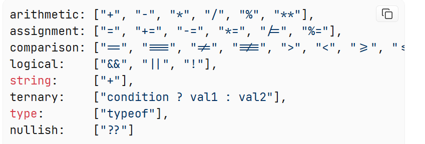
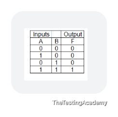
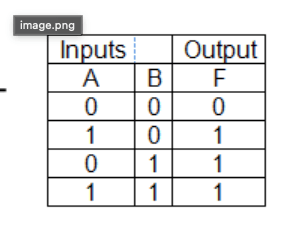
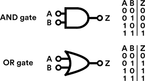
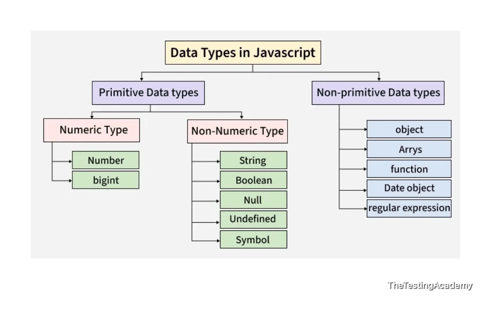

## Date:  09/10/2026  

## Operators ##

> let a = 10;

= -> Operator

**An operator is a symbol** that performs an operation on values (called operands). In the expression 10 + 3, the + is the operator and **10 and 3 are the operands.** 

Examples:  

let a = 10;  

let b = 20 + 10;  

console.log(a);     
console.log(b);  

console.log("Sum of a and b:", a + b);  

Here = is assignment Operator and + is an Arithmetic Operator  

JavaScript groups its operators into a few main types:  

arithmetic: ["+", "-", "*", "/", "%", "**"],  
assignment: ["=", "+=", "-=", "*=", "/=", "%="],  
comparison: ["==", "===", "!=", "!==", ">", "<", ">=", "<="],  
logical:    ["&&", "||", "!"],  
string:     ["+"],  
ternary:    ["condition ? val1 : val2"],  
type:       ["typeof"],  
nullish:    ["??"]  

  

## Assignment Operators ##

let x = 10;  

x= "Playwirhgt test";  

console.log(x);  
 
let x1= 5;  

x1 = x1+ 10;  
console.log(x1);  

x1 += 10; // Using the assignment operator +=  console.log(x1);

## Aritmetic Operators ##

// Arithmetic Operators  are  + , - , * , / , % , ++ , --  

let a = 10;  
console.log(a);  

let b = 5;  
console.log(b);  

console.log("a + b =", a + b);  
console.log("a - b =", a - b);  
console.log("a * b =", a * b);  
console.log("a / b =", a / b);  // Division operator gives the quotient  
console.log("a % b =", a % b);  // Modulus operator gives the remainder  
console.log("a % b =", a % b);  

a++;  
console.log("a after increment =", a);  

a--;  
console.log("a after decrement =", a);  

### Exponentiation operator 
console.log("2 ** 3 =", 2 ** 3);  // 2 raised to the power of 3 i.e 2^3
console.log("3 ** 4 =", 3 ** 4);  // 3 raised to the power of 4 i.e 3^4

## Comparision Operators ##

#### The Core Difference
- ===  **(strict equality)** — checks **both value AND datatype**. No conversion.
- `**==**`  **(loose equality)** — checks **value only**, after converting both sides to the same type (type coercion).

console.log(5 == "5");   -->  true because loose comparison only checks values  
console.log(5 === "5");  -->  false because strict comparison checks both value and type  

## Logical Operators 
OR gate

  

And Gate

    

    

## Confusing Comparision

console.log("" == 0); //true  
console.log("0" == 0);  // true  
console.log(""  == "0" );  // Here both are string compare as it is   
// Transitivity broken because "" == 0 and 0 == "0" but "" != "0"  -> Coerced  

## Ternary operator
- **Condition** either this or either data.  

- Syntax -> condition ?  if(true) do this :  if false(do this)  

- ` **condition** ?  value1(if true)  : value2 (if false)` 

Ex:  
let age =20;

let canDrive = age >= 16 ? "Yes" : "No";  
console.log(`Can the person drive? ${canDrive}`);     

let canDrink = age >= 25 ? "Yes" : "No";  
console.log(`Can goto Goa & Drink? ${canDrink}`);  

Condition :   age >= 25 , if true then "Yes" is assigned to canDrink else "No" is assigned to canDrink

Ex:

let statusCode= 200;   
let statusErorCode= 400;  

let expectedStatus = 200;     
let statusMessage = statusCode === expectedStatus ? "Success" : "Failure";  
console.log(`Status check: ${statusMessage}`);  

let errorMessage = statusErorCode === expectedStatus ? "Success" : "Failure";  
console.log(`Status check: ${errorMessage}`);  

Output:  
Status check: Success  
Status check: Failure  

Ex: 

let environment = "production";  
let baseUrl = environment === "production" ?   
"httpr://prodUrl.com" : "https://stagingUrl.com";  

console.log(`Base URL: ${baseUrl}`);  
//console.log("environment " + environment);  

let baseUrl2 = environment === "Staging" ?   
"httpr://prodUrl.com" : "https://stagingUrl.com";  

console.log(`Base URL: ${baseUrl2}`);  

Output:  
Base URL: httpr://prodUrl.com  
Base URL: https://stagingUrl.com  

Ex:  

let responseTime = 850; // ms  
let sla = 1000;         // ms  

let slaStatus = responseTime <= sla  
    ? "Within SLA ✅"  
    : "SLA breached ❌";  

console.log(`Response: ${responseTime}ms - ${slaStatus}`);  

Ouput:  

Response: 850ms - Within SLA ✅

### Ternary operator with Multiple conditions

## Data type in JavaScript
    