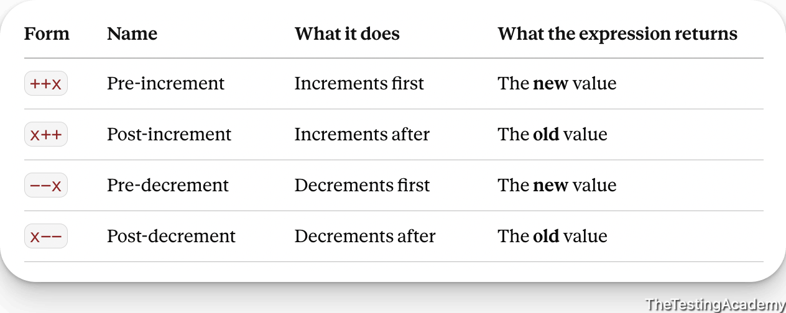
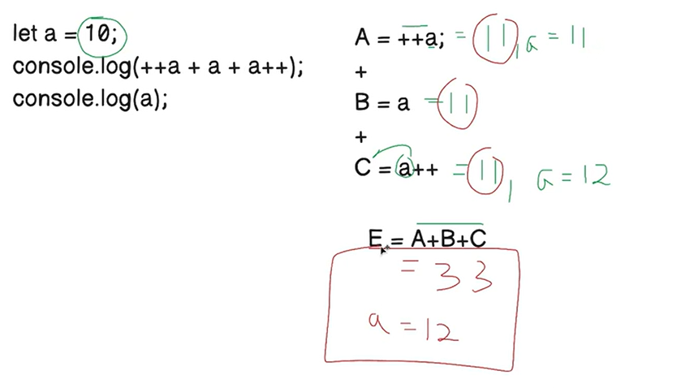
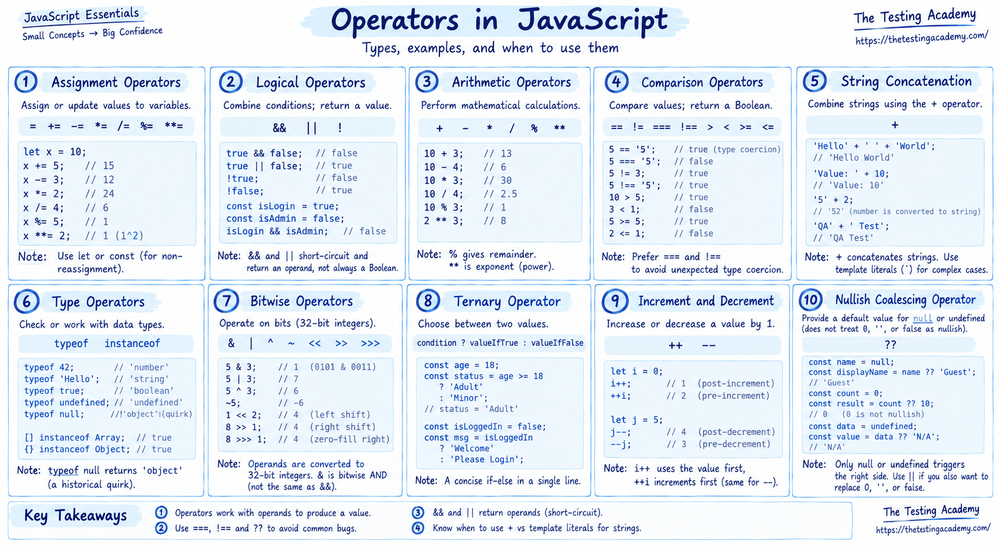

## Increment and decrement Operator ( ++, --) 

Pre and Post 

 let a= 10;

- pre -   ++a ->. Pre
    - **first increase the value by 1, then assign the value.**

- post a++ ->  
    - **First, assign the value, then increment by 1**

### Pre-Increment

let a = 23;  
let b = a++;   
console.log("b Value : ", b );  
console.log("a Value : ", a );  

Output:  
    b = 23 (first assign a value to b)  
    a = 24(after 'a' value asssigned to 'b' then a value is increase by 1)

### Post-Increment  
Ex:1  
let x= 10;
let y= ++x;
console.log(y);
console.log(x);

Output:  
y = 11 (First 'a' value will be increased by 1 then assign to'b' , so b =11)  
a =1 (Since already increase value is assigned to 'a')  

Ex:2  
let  a =10;  
console.log(++a + a) ;  

Output: 22 (First a is increased by 1 i.e 10+1 =11, then aritmetic operation will happended)  
Here a=11, a+a = 22

Ex:  
> a++ + +++ a++ a +++a + 

**Increment**

1. Pre Increment -> ++a; 
2. Post Increment -> a++;

**Decrement**

1. Pre Decrement -> --a;
2. Post Decrement -> a--;

    
 

Ex: 1 
let a =10;  
console.log("Outout of ++a + a + a++   ===>", ++a + a + a++ );  
console.log("Value of a after the operation: ", a);  

This demonstrates the combination of pre-increment and post-increment operators in a single expression.  
 A = ++a --> A= 11  & a=11
 B = a --> B= 11 (after pre-increment)    , & a=11  
 C = a++ --> C= 11 (post-increment, a becomes 12 after this)  , a= 12  
 Final value of a after the entire expression: 33  
 Final values of 'a' is 12

   

 Ex2:  
 let i = 1;  

let result = i++ + ++i;  
console.log("Result of i++ + ++i ===>", result);  
console.log("Value of i after the operation: ", i);  

This demonstrates the combination of post-increment and pre-increment operators in a single expression.  
Initial value of i: 1  

A = i++ --> A= 1 (post-increment, i becomes 2 after this)  

B = ++i --> B= 3 (pre-increment, i becomes 3 before this)  

Result = A + B = 1 + 3 = 4  

Final value of i after the entire expression: 3  

## Nullish Coalescing
This operator makes sure that if the value is null, then the right-hand side value will be assigned.   

let amul = null;  
let val = amul ?? "NANDANI Milk";  
console.log(val);  
 
This demonstrates the nullish coalescing operator (??).  
Initial value of amul: null  
val = amul ?? "NANDANI Milk" --> val = "NANDANI Milk" (because amul is null)  
Final value of val: "NANDANI Milk"  

let api_response = null;  
let responsedata = api_response ?? "{}";  
console.log(responsedata);  

let api_response1 = "Pramod";  
let responsedata1 = api_response1 ?? "{}";  
console.log(responsedata1);  

** If api_response1 were null, the nullish coalescing operator would provide the default value "{}".    
** if api_response1 is not null, the nullish coalescing operator will return the actual value of api_response1, which is "Pramod".

## Bitwise Operators  

These operators are mostly used in electronics, if you have remembered. Anyone from electronics and communication  

5 & 1    // 1  (AND)  
5 | 1    // 5  (OR)  
5 ^ 1    // 4  (XOR)  
~5       // -6 (NOT)  
5 << 1   // 10 (Left shift)  
5 >> 1   // 2  (Right shift)  

www.rapidtables.com/   

## Operators 

1. Assignment (=)   
2. Logical  (&&, ||)  
3. Arithmetic  (+,- ,*,/, %)
4. Comparison  (==, ===, != ,!==)
5. String Concat (+) 
6. Type  
7. Bitwise (&, |)  
8. Ternary  (? : :)
9. Increment and Decrement - (++,--)
10. Nullish Coalescing  

  

