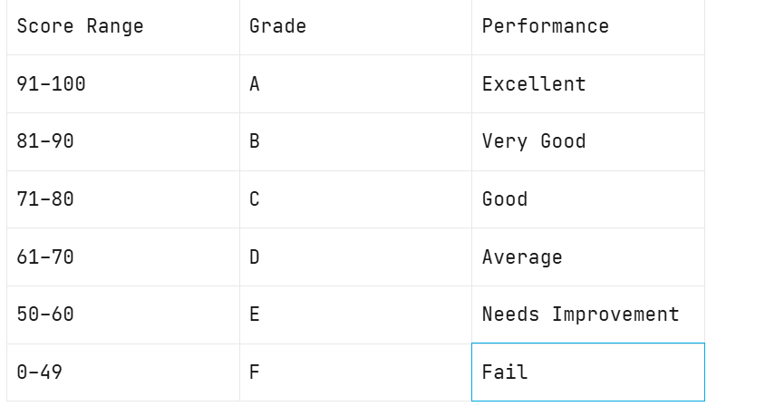
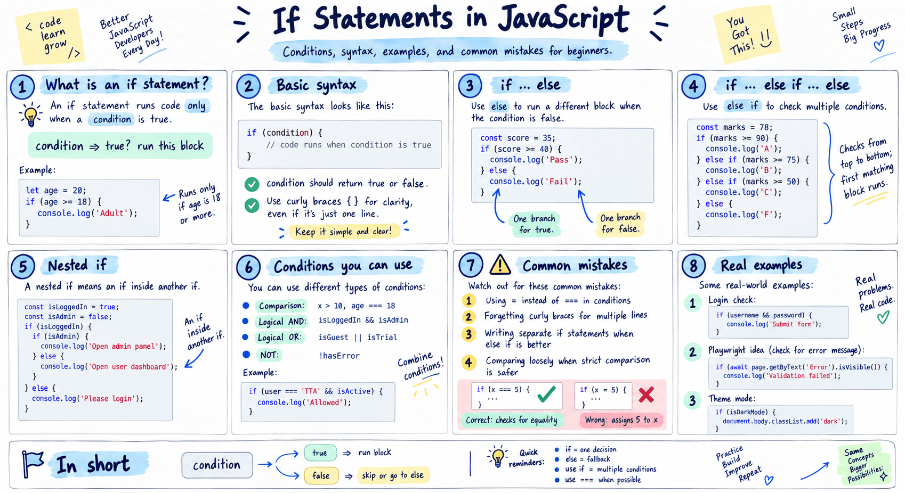

# Conditions and Loops

## if and else
- The `if/else`  statement is JavaScript's most fundamental decision-making tool. 
- It executes a block of code if a condition evaluates to `true` , and optionally runs a different block if the condition is `false` . 
- You can chain multiple conditions using `else if` .
- **if (condition) {**
 // runs if condition is true
} else if (anotherCondition) {
 // runs if anotherCondition is true
} else {
 // runs if ALL conditions are false
}

### Problem Statement
Write a JavaScript program that accepts a student's exam score and determines the corresponding grade using conditional statements (`if`, `else if`, and `else`).

The score must be between 0 and 100 (inclusive).

### Grading Criteria

### Requirements
1. Accept a student's score as input.
2. Use `if` , `else if` , and `else`  statements to determine the grade.
3. Print the student's score and corresponding grade.
4. If the score is less than 0 or greater than 100, display `"Invalid Score"` .
5. Handle boundary values correctly, such as `0` , `49` , `50` , `60` , `70` , `80` , `90` , and `100` .

### Sample Input and Output  

Input: 95
Output: Grade A - Excellent

Input: 85
Output: Grade B - Very Good

Input: 75
Output: Grade C - Good

Input: 65
Output: Grade D - Average

Input: 55
Output: Grade E - Needs Improvement

Input: 35
Output: Grade F - Fail

Input: 105

Ex: 
let score = 87;

if (score > 100 || score < 0) {
    console.log("Invalid score");
} else {
    // Score valid

    if (score > 90) {
        console.log(" Grade A - Excellent");
    }
    else if (score > 80 && score <= 90) {
        console.log("Grade B - Very Good");
    }
    else if (score > 70 && score <= 80) {
        console.log("Grade C - Good");
    }
    else if (score > 60 && score <= 70) {
        console.log("Grade D - Average");
    }
    else if (score > 50 && score <= 60) {
        console.log("Grade E - Needs Improvement");
    }
    else {
        console.log("Grade F - Fail");
    }
}

Output:
Grade B - Very Good

### Note
When we have single line condition then use 'Ternary' operators  
When we have multiple line  then use if..else