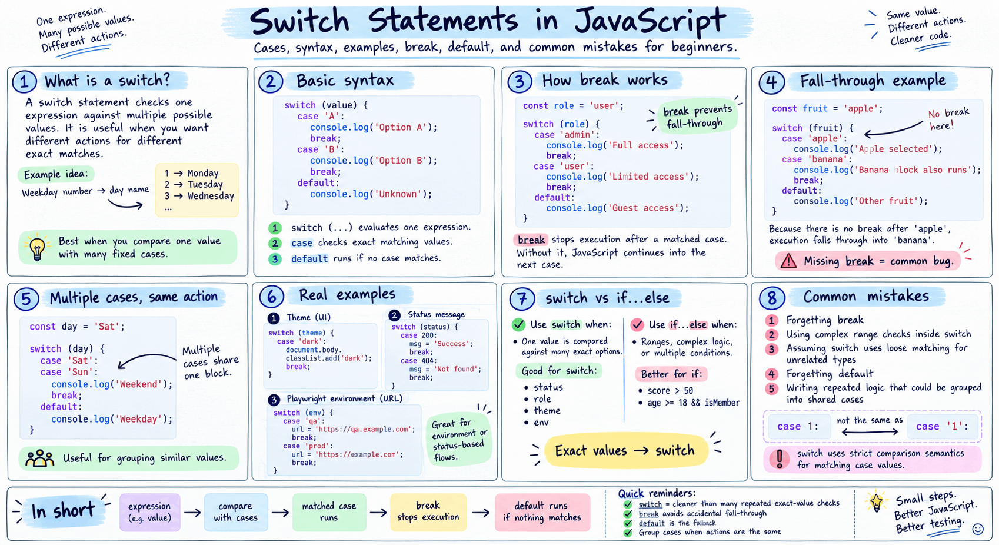

## Switch Statement in JavaScript

The `switch` statement evaluates an expression once and then compares **it against multiple** `**case**` **values.** 

**expression** -> case 1, case 2, case 4.....  default....

- When a match is found, the code for that case runs. 
- It is cleaner than long if/else if chains when comparing a SINGLE value against many options. 
- Switch uses **strict comparison (===)**.


**Q1: What is the difference between** if(x == 5) and if(x === 5) in testing?**  

Always use `**===**` (strict equality) in tests. `==` does type coercion: `"5" == 5` is true but   `"5" === 5` is false. In QA, strict equality catches type bugs.


```
switch (expression) {
    case value1:
        // code block
        break;       // IMPORTANT: stops fall-through
    case value2:
        // code block
        break;
    default:
        // runs if no case matches (optional)
}
```

**Q2: What happens if you forget the `break` statement?**

**A: The code "falls through" and executes ALL subsequent cases until it hits a `break` or the switch ends. This is the #1 switch bug. Always include break unless fall-through is intentional (and add a `// fall-through` comment).




Switch statments:

```
let signal = "Yellow";

switch (signal) {
    case "Red":
        console.log("Red Signal");
        break;
    case "Yellow":
        console.log("Yello Signal");
        break;
    case "Green":
        console.log("Green Signal");
        break;
    default:
        console.log("No signal");
}
```

Without 'break' in statement

```
let role = "Admin";

switch (role) {
    case "Admin":
        console.log("Admin role");        
    case "Manager":                 // Since the above case does not have a break, it will 
                                    // fall through to this case
        console.log("Manager role");
        break;
    case "User":
        console.log("Read role");
        break;
    default:
        console.log("Access Denied");
}
```

Deafult statement

```
let browser = "Opera";

switch (browser) {
    case "Chrome":
        console.log("Chrome browser");
        break;
    case "Firefox":
        console.log("Firefox b");
        break;
    case "Edge":
        console.log("Edge browser");
        break;
    default:
        console.log("Browser not supported");
}
```

Switch with same condition multiple times

```
let code = 500;

switch (code) {
    case 200:
        console.log("200 Success");
        break;
    case 201:
        console.log("201 Created");
        break;    
    case 500:
        console.log("500 Internal Server Error");
        //break;
    case 500:
        console.log("512 Server Error");
        break;
    case 401:
        console.log("401 Unauthorized");
        break;  
    case 400:
        console.log("400 Bad Request");
        break;
    case 404:
        console.log("404 Not Found");
        break;
    default:
        console.log("Unknown response");
}
```
These are good for practicing:  

String-based switch  
Number-based switch  
Browser testing scenarios  
API response handling  
Playwright automation environments  
User roles and access control logic  

Switch Groups
```
let browser = "Brave";

switch (browser) {
    case "Chrome":
    case "Edge":
    case "Brave":
    case "Opera":
        console.log("Chromium Project!");
        break;

    case "Firefox":
        console.log("Mozilla Project!");
        break;

    case "Safari":
        console.log("Apple browser - uses JavaScriptCore engine");
        break;

    default:
        console.log("Unknown browser - manual testing needed");
}
```

Without break statement in switch condition
```
let fruit = "banana";

switch (fruit) {
    case "apple":
        console.log("Apple selected");

    case "banana":
        console.log("Banana selected");

    case "cherry":
        console.log("Cherry selected");

    case "date":
        console.log("Date selected");

    default:
        console.log("Default reached");
}
```
Output:   
Banana selected  
Cherry selected  
Date selected  
Default reached  