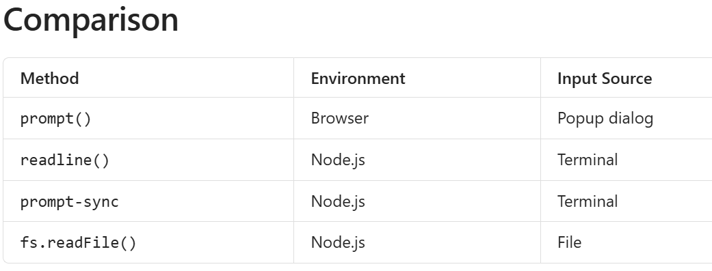
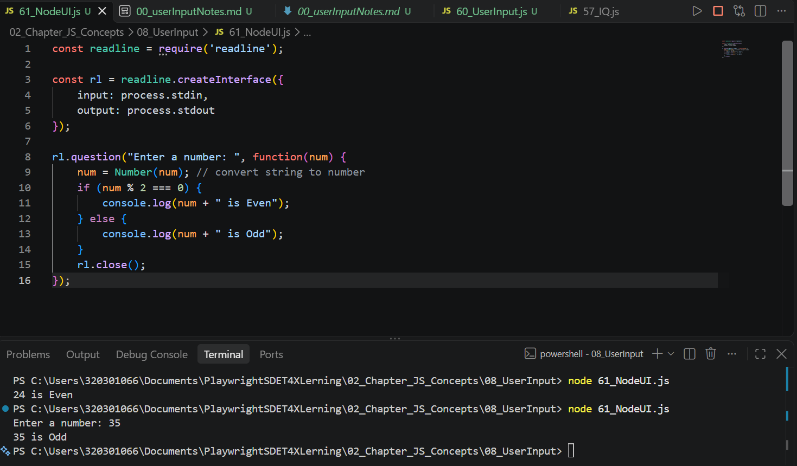

## JavaScript User Input

**Note: Direct Input of Java Script is not available , we need to use external librabries**

Here we are using Node to provide input values  

1. prompt()  
2. readline() -> NodeJS  
3. promt-sync -> NodeJS  
4. fs.readFile() -> NodeJS  

In JavaScript, there are several ways to take user input depending on whether you're running code in a browser or in Node.js.  

**1. prompt() (Browser)**

Used in web browsers to get input from a user through a popup dialog.  

let name = prompt("Enter your name:");  
console.log(name);  

Output:  
Enter your name: John John  

When to use:

- Browser-based JavaScript  
- Learning and practice  
- Simple user interaction  

Limitation:  

❌ Does not work directly in Node.js  

**2. readline() (Node.js)**  

Built-in Node.js module for reading input from the terminal.  

```
const readline = require("readline");

const rl = readline.createInterface({
    input: process.stdin,
    output: process.stdout
});

rl.question("Enter your name: ", (name) => {
    console.log("Hello " + name);
    rl.close();
});
```
Output:  
Enter your name: John  
Hello John  

When to use:  
- Command-line applications  
- No extra package installation required  

**3. prompt-sync (Node.js)**  

A third-party package that makes user input easier.  

Install  
npm install prompt-sync  

```
const prompt = require("prompt-sync")();

let name = prompt("Enter your name: ");

console.log("Hello " + name);
```

Output:  
Enter your name: John  
Hello John  

Advantage  
✅ Looks similar to prompt() in browsers  

✅ Easier than readline()  

**4. fs.readFile() (Node.js)**  
Reads input from a file instead of typing in the console.  

Suppose data.txt contains:  

John  
25  
India  

```
const fs = require("fs");

fs.readFile("data.txt", "utf8", (err, data) => {
    if (err) {
        console.log(err);
        return;
    }

    console.log(data);
});
```

Output:  

John  
25  
India  

When to use  
- Reading configuration files
- Processing large datasets
- Automation scripts  
  



Examples:

