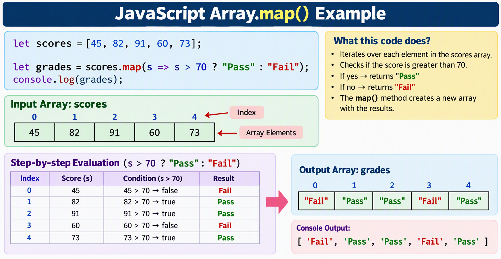
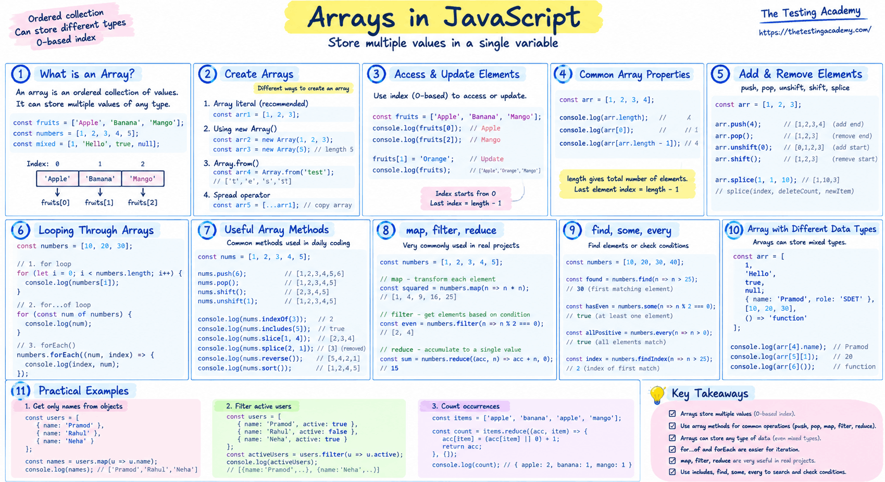

# Arrays
- Arrays are ordered collections of values. 
- JavaScript arrays are dynamic and can hold mixed types.
- An ordered, zero-indexed, **mutable** collection.
-  `typeof []`  is `"object"`  -> use `Array.isArray()`  to check.'  


```
const browsers = ["chrome", "firefox", "webkit"];
console.log(browsers[0]);          // chrome
console.log(browsers.at(-1));      // webkit  (negative index)
console.log(browsers.length);      // 3
```

## What is an Array in JavaScript?

An Array is a special variable in JavaScript that can store multiple values in a single variable.  

Instead of creating separate variables:  

```
let fruit1 = "Apple";
let fruit2 = "Banana";
let fruit3 = "Mango";
```

You can store them in one array:  
let fruits = ["Apple", "Banana", "Mango"];  

### Why Use Arrays?  

Arrays help you:  

Store multiple related values together  
Access data using an index  
Loop through a collection of items  
Add, remove, and modify elements easily  

### Array Index
Array indexes start from 0.

```
let fruits = ["Apple", "Banana", "Mango"];

console.log(fruits[0]); // Apple
console.log(fruits[1]); // Banana
console.log(fruits[2]); // Mango
```

Visualization:

```
Index:   0        1        2
Value: Apple   Banana   Mango
```


```
const browser = ["Chrome", "Firefox", "Edge", "Safari "]
console.log(browser[0]);
console.log(browser[2]);    

console.log(browser.at(-1));
console.log(browser.length);        

```

**Note:**  
Negetive index also supporting by JavaScript  


**Note:**  
**Typeof an array is an Object**

**at() suports the negative index also**  

**Negative index is only supported by at()**

**Array's are mutable in nature-> Means their value can be change**
```
let fruits = [];
console.log(typeof fruits);

let browsers = ["chrome", "firefox", "webkit"];
console.log(browsers.length);

// console.log(browsers.at(0));
console.log(browsers[0]);
// console.log(browsers[-1]);

console.log(browsers.at(-1));
```

console.logs(browser.at(-1))  ---> Valid  
console.logs(browser[-1])     ---> Undefined

Ex:  
```
let browser = ["Chrome", "Firefox", "Edge", "Safari"]; --> Direct creation

let scores = new Array(5);  --> Create an Empty array
scores[0]   = "1";
scores[1] = "2";    
scores[2] = "3";
scores[3] = "4";
scores[4] = "5";

console.log(scores[4]); 
console.log(scores.at(4));
console.log("---------------------------")

let marks = new Array(25,45,49);  --> Array creation with values
console.log(marks.length);
console.log("---------------------------")
for(let i=0 ; i< browser.length; i++)
{
console.log(browser[i]);
}
console.log("---------------------------");  
let char= Array.of('A','B','C','D');  --> Created Array with **Of**
console.log(char.length);
console.log("---------------------------");     
for(let i=0 ; i< char.length; i++)  
{
    console.log(char[i]);
}

OR
console.log(char);
[ 'A', 'B', 'C', 'D' ]

Array.from()  
let chars = Array.from("Hello");   ---> Crate characters of Array from String
Output: [ 'H', 'e', 'l', 'l', 'o' ]

```

Example:  
```
let result = ["Pass", "Fail", "Skip"];

console.log(result[0]);  // Pass
console.log(result[2]);  // Skip
console.log(result[4]);  // undefined

console.log(result.at(-1));  // Skip    
console.log(result.at(-2));  // Fail
console.log(result.at(-3));  // Pass
console.log(result.at(-4));  // undefined


// Modifying array values 
result[1] = "Incomplete";  // Modifying the second element
console.log(result);  // ["Pass", "Incomplete", "Skip"] 

console.log(result.length);
```

### Adding to & Removing from an Array
```
let arr = [1, 2, 3]
console.log(arr.length);
console.log(arr);

//Add Element to End

arr.push(4);
console.log(arr);

//Remove Element from End
arr.pop();
console.log(arr);

arr.push(5, 6); //Appends new elements to the end of an array, and returns the new length of the array.
console.log(arr);

//Add Element to Beginning
arr.unshift(0);
//Inserts new elements at the start of an array, and returns the new length of the array.
console.log(arr);

//Remove Element from Beginning
arr.shift();
//Removes the first element from an array and returns it. If the array is empty, undefined is returned and the array is not modified
console.log(arr);
```

### Splice functionality
```
arr.splice(2, 1); // 2 Index, 1 number of elements
//Removes elements from an array and, if necessary, inserts new elements in their place, 
// returning the deleted elements.
console.log(arr);

arr.splice(2, 0, 99);
console.log(arr);
[ 1, 2, 99, 5, 6 ]

(method) Array<number>.splice(start: number, deleteCount: number, ...items: number[]): number[] (+1 overload)

Removes elements from an array and, if necessary, inserts new elements in their place, 
returning the deleted elements.

@param start — The zero-based location in the array from which to start removing elements.

@param deleteCount
The number of elements to remove. If value of this argument is either a negative number, zero, 
undefined, or a type that cannot be converted to an integer, the function will evaluate the argument as zero and not remove any elements.

@param items — Elements to insert into the array in place of the deleted elements.

@returns — An array containing the elements that were deleted.


arr.splice(2, 0, 98); // Index 2, start from 0 --> Will Inset the value , not delete the value
console.log(arr);

[ 1, 2, 98, 99, 5, 6 ]
arr.splice(2, 1, 100); // Index 2, start from 1 --> Will delete & Replace the value 
console.log(arr);
[ 1, 2, 100, 99, 5, 6 ]

**arr.splice(2, 2, 101);** // Index 2, start from 2 -->  delete two items & Replace the new value 
console.log(arr);

splice() uses this format:  
For:  
2 — start at index 2 (the third element; array indexes start at 0).  
2 — remove two elements, starting there.  
101 — insert 101 at that same position.  
In your file, the earlier splice() calls have changed the array to:  
At index 2 is 100, and the next element is 4. So this call removes 100 and 4, then inserts 101:  

splice() modifies the original array. It also returns the removed elements—in this case, [100, 4].  

Output:   
//[ 1, 2, 101, 5, 6 ]  

Explaination:
Index:  0  1    2  3  4  5  
Value: [1, 2, 100, 4, 5, 6]  

arr.splice(2, 2, 101);  
Start at index 2, which contains 100.  
Remove 2 elements: the values at index 2 (100) and index 3 (4).  
Insert 101 at index 2.  
The result is:  
Index:  0  1    2   3  4
Value: [1, 2, 101, 5, 6]

splice() changes the original array. The removed elements are [100, 4].  

arr.splice(1,2,10,20);// Replace 2 elements with 10 & 20
console.log(arr);
```
### Add and remove elements ###

```
let browser = ["Chrome", "Firefox", "Edge", "Safari"]
console.log(browser);

browser.push("Opera"); //Insert at End of the array
console.log(browser);

browser.pop(); // Remove element at End of the array
console.log(browser);

browser.shift();  // Remove First element of the array
console.log(browser);   

browser.unshift("Chrome"); // Insert at Beginning of the array
console.log(browser);
```

### IndexOf and Includes
```
let results = ["Pass", "fail", "Skip" ,"Error", "fail"];
console.log(results);


console.log(results.indexOf("fail")); 
// Returns the index of the first occurrence of "Fail" 

console.log(results.indexOf("Fail")); 
// Returns -1 because "Fail" with uppercase "F" is not found in the array

console.log(results.indexOf("Skip"))
// Returns the index of the first occurrence of "Skip"

console.log(results.includes("Fail"));          

console.log(results.includes("fail")); 
// Returns true because "fail" is found in the array

console.log(results.includes("Pass"));
// Returns true because "Pass" is found in the array
```

## Finds
```
let numbers = [10, 23, 45, 35, 67, 89];
let found = numbers.find(num => num > 33);
console.log(found);
```
### How find() works  

find() returns the first element that satisfies the condition.  
 
Checking each value:  
```
10 > 33  ❌ false
23 > 33  ❌ false
45 > 33  ✅ true  ← first match
35 > 33  ✅ true
67 > 33  ✅ true
89 > 33  ✅ true
```
Since 45 is the first number greater than 33, find() stops searching and returns: 45  
"Start from the beginning of the array and return the first element whose value is greater than 33."  
That's why the result is 45, not 35. The array is checked from left to right, and 45 appears before 35.  

### Difference between find() and filter()
If you want all numbers greater than 33:
```
let result = numbers.filter(num => num > 33);
console.log(result);

Ouput:
[45, 35, 67, 89]
```

If you want the first number greater than 33:  
```
let result = numbers.find(num => num > 33);
console.log(result);

Output: 45
```
### FindIndex
```
let numbers = [10, 23, 45, 35, 67, 89]
let index = numbers.findIndex(num => num > 33); 
// Finds the index of the first number greater than 33
console.log(index);
// Returns the index of the first number greater than 33, which is 2

console.log(numbers.findLast(num => num >46));
//Returns the value of the last element in the array where predicate is true, and undefined otherwise.

console.log(numbers.findLastIndex(num => num >46));

```

### forEach
forEach() is an array method used to execute a function once for each element in an array.

```
array.forEach(function(element, index, array) {
    // code to execute
});
```
element → Current array value  
index (optional) → Current index  
array (optional) → Original array  

```
let fruits = ["Apple", "Banana", "Mango"];

fruits.forEach(function(fruit) {
    console.log(fruit);
});
```

```
let browsers =[ "chrome", "Firefox","Opera","Edge"];
console.log("-------- For Loop ----------------");
for (let i=0; i<browsers.length; i++) {
    console.log(browsers[i]);
}

console.log("-------- Of ----------------");
for (let x of browsers)
{
    console.log(x);
}

let browsers2 =[ "chrome", "Firefox","Opera","Edge"];
console.log("---------- forEach() --------------");  

browsers2.forEach((browser, index) => {
    console.log(index, browser);
});
```

## Tranforming array using MAP

map() is an array method that creates a new array by applying a function to each element of an existing array.  

The map() method is used to iterate over an array and transform each element, returning a new array with the modified values.  

**map() is used to transform each element of an array and return a new array containing the transformed values.**

```
Example:
let numbers = [1, 2, 3, 4];

let doubled = numbers.map(num => num * 2);

console.log(doubled);

Ouptu:
[2, 4, 6, 8]
```

```
let scores = [45, 82, 91, 60, 73];

let grades = scores.map(score =>
    score > 70 ? "Pass" : "Fail"
);

console.log(grades);

Output:
["Fail", "Pass", "Pass", "Fail", "Pass"]
```
Key Points

✅ Creates a new array

✅ Does not modify the original array

✅ Returns an array of the same length

✅ Executes a callback function for every element



Here is the cleaned and redesigned version of your JavaScript map()   example image. It clearly shows:  

The original scores array  
How map() processes each element  
Index positions  
Step-by-step evaluation  
The resulting grades array  
Final console output  
 

 ```
 Difference Between map() and forEach()
     map()	                |     forEach()
Returns a new array	        |   Returns undefined
Used for transforming data	|   Used for performing actions
Can be chained	            |   Cannot be chained effectively
```

## Filter

The filter() method creates a new array containing only the elements that satisfy a specified condition. The original array remains unchanged.  

Filter is function, it will create a new array with all elements that pass the test implemented by the provided function.


```
Example:
let score = [45, 67, 95, 57, 88];

let pass = score.filter( s => s >=60);
console.log(pass);
[ 67, 95, 88 ]
```


### Map Vs Filter

| map()                       | filter()    
|-----------------------------|------------| 
| Transforms every element    | Selects matching elements       | 
| Returns a new array         | Returns a new array    | 
| Output array length is usually same as input|Output array length can be smaller|
| Used to modify data         |  Used to filter data  |
|Returns one value for each element |   Returns only elements that satisfy a condition    |
 

 ```
 Map Example:

 let scores = [45, 82, 91, 60, 73];

let grades = scores.map(
  score => score > 70 ? "Pass" : "Fail"
);

console.log(grades);

Output:["Fail", "Pass", "Pass", "Fail", "Pass"]

45 → Fail
82 → Pass
91 → Pass
60 → Fail
73 → Pass
✅ Every element is transformed.
```

```
filter() Example:

let scores = [45, 82, 91, 60, 73];

let passScores = scores.filter(
  score => score > 70
);

console.log(passScores);

Output:
[82, 91, 73]

45 → Removed
82 → Kept
91 → Kept
60 → Removed
73 → Kept

✅ Only matching elements are returned.

map()    ==> Modify Every Element
filter() ==> Keep Matching Elements
```

**map() is used to transform each element of an array and returns a new array of the same length, whereas filter() is used to select elements based on a condition and returns a new array containing only the matching elements.**

### Summary
