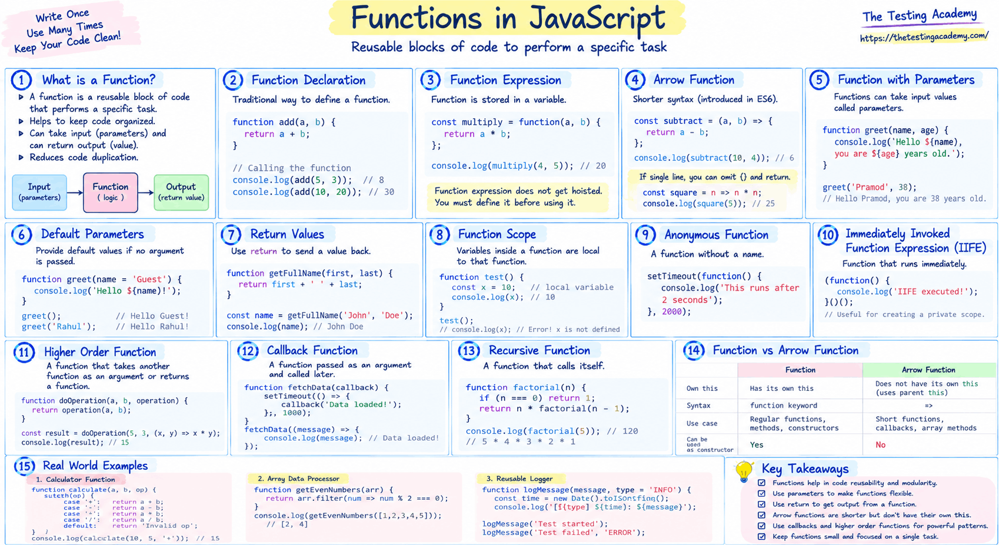

# Functions in JS
>  JavaScript, if you remember, is all about functions.

- A function is a **reusable block of code that performs a specific task.** 
- Instead of repeating logic, **you define it once** and call it whenever needed.

1. Define / Definition a Function.
2. Calling of Functions

**Function Define**

function name(parameter){

// Code which you want to execute

// return or no return

}

**Function Call**

name(arguments)

1. Built in JS functions
2. User Defined
    1. Type 1
         no return or no argument

        ```
        function test(){
        console.log("No return value.");
        }
        test(); // Calling the function

        function sayHello(){
            console.log("Hello!");    
            console.log("No return value.");
            }
            sayHello(); // Calling the function
       ```

    2. Type 2
         with return or no argument

        ```
        function add ()
        {
            return 3 + 4;
        }

        console.log(add()); // Calling the function and printing the return value;

        ```

    3. Type 3
        no return or with argument
        ```
        function add(a, b) {
        console.log(a + b);
        }
        add(3, 4); // Calling the function with arguments 3 and 4

        
        function greetByName(name) {
        console.log("Hello, " + name + "!");
        }
        greetByName("Alice"); // Calling the function with argument "Alice"
        greetByName("Jeans"); // Calling the function with argument "Jeans"
        greetByName("Bob"); // Calling the function with argument "Bob"
        greetByName("Charlie"); // Calling the function with argument "Charlie"

        function generateSlno(start) {
        for(let i = 1; i <=  start ; i++) {
        console.log(i);
        }
        }   
        generateSlno(5); // Calling the function with argument 5
        ```

    4. Type 4
        with return or with argument

        ```
        function sum(a, b) {
        return a + b;
            }   
        let result = sum(3, 4);
        console.log(result); // This will print 7
        console.log(sum(5, 6)); // This will print 11
        console.log(sum(7, 8)); // This will print 15        
        ```

    5. Default Parameter Fn
    6. Anonymous Fn
    7. Arrow Fn
    8. IIFE - Immediately Invoked Function Express
    9. Higher Order Function
    10. Recursive Function

```
Parameter = placeholder in function definition.
Argument = actual value passed at call.

function add(a, b) {      // a, b → parameters
    return a + b;
}

add(10, 20);              // 10, 20 → arguments


Comparison:

Parameter:
- Where: Function definition
- Type: Variable name
- Lives: Inside function scope

Argument:
- Where: Function call
- Type: Real value
- Lives: Caller scope until passed
```

## Console.log vs Return
`**console.log**` = print to terminal/devtools (side effect, for humans). 

`**return**` = send value back to caller (data flow, for code).

```
function addLog(a, b) {
  console.log(a + b);    // prints, returns nothing
}


function addReturn(a, b) {
  return a + b;          // gives value back
}

let x = addLog(2, 3);       // prints something, x = undefined
let y = addReturn(2, 3);    // prints nothing, y = 5
```
```
function greet(name){
    return `Hello, ${name}`;
}

const greet1 = function(name){
    return `Hello, ${name}`;
}

// Arrow Fn
const greet2 = (name2) => `Hello, ${name2}`;
// If you want to make a normal function to arrow function. 
// Remove the keyword function, remove the keyword return, remove the curly braces, and use the =>
```


