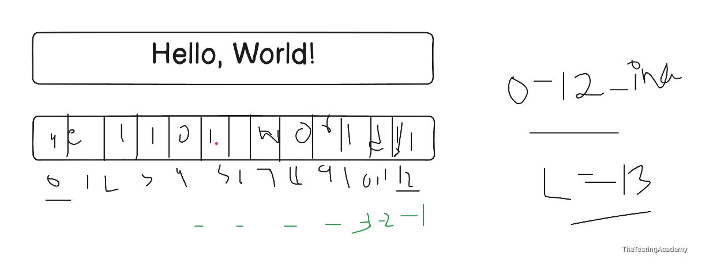
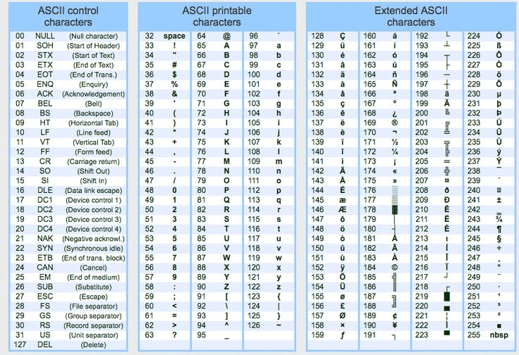
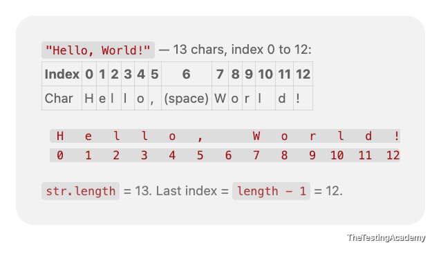
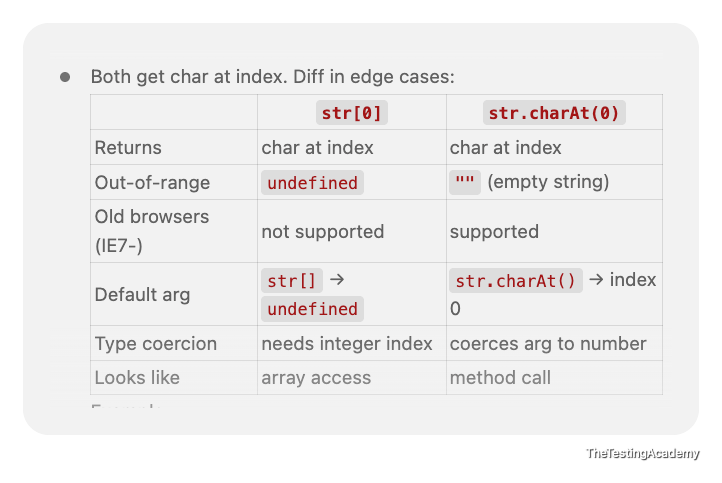
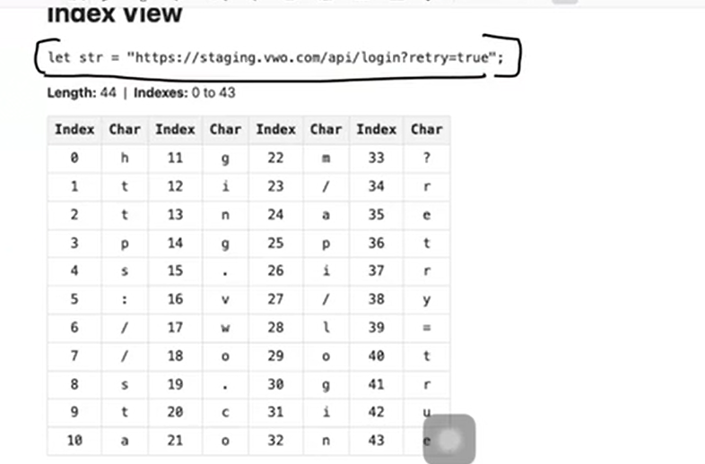
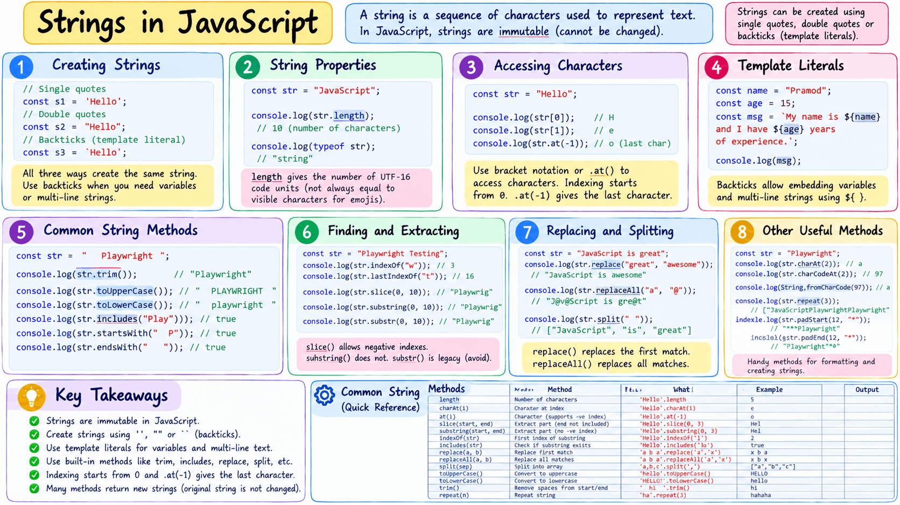

# String and Objects


# Strings
- Strings are **sequences of characters.** 
- JavaScript provides many methods for string manipulation.
- A string is a sequence of characters used to represent text. 
- In testing, strings are everywhere -> **URLs, selectors, assertions, response messages, log parsing.**


## Creating Strings
```
let url = "https://app.vwo.com";
let status = 'pass';
let message = `Test completed in ${320}ms`;  // template literal
```


   

   

JavaScript example:

```
console.log("A".charCodeAt(0)); // 65
console.log("Z".charCodeAt(0)); // 90
console.log("a".charCodeAt(0)); // 97
console.log("z".charCodeAt(0)); // 122
```


   

 

   

   