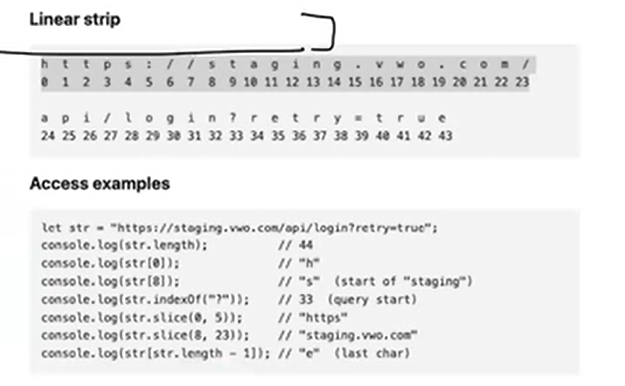

# String and Objects


# Strings
- Strings are **sequences of characters.** 
- JavaScript provides many methods for string manipulation.
- A string is a sequence of characters used to represent text. 
- In testing, strings are everywhere -> **URLs, selectors, assertions, response messages, log parsing.**


## Creating Strings
```
let url = "https://app.vwo.com";
let status = 'pass';
let message = `Test completed in ${320}ms`;  // template literal
```


   

   

JavaScript example:

```
console.log("A".charCodeAt(0)); // 65
console.log("Z".charCodeAt(0)); // 90
console.log("a".charCodeAt(0)); // 97
console.log("z".charCodeAt(0)); // 122
```


   

 

   

let str = "https://staging.vwo.com/api/login?retry=true";

  

   

# JavaScript String Methods 

All outputs verified on Node.js v22. Strings are **immutable** -> every method returns a _new_ string.

```
let s = "abc";
s[0] = "z";
console.log(s);   // 'abc'  ← silently unchanged
```

## 1. Length & Character Access
| <u>Method</u> | <u>Purpose</u> | <u>Example</u> | <u>Result</u> |
| ----- | ----- | ----- | ----- |
| `.length`  | character count (property, not a method) | `"Playwright".length`  | `10`  |
| `.charAt(i)`  | char at index | `"Playwright".charAt(4)`  | `'w'`  |
| `[i]`  | char at index (bracket) | `"Playwright"[4]`  | `'w'`  |
| `.at(i)`  | <p>char at index,</p><p> </p><p>**supports negative**</p> | `"Playwright".at(-1)`  | `'t'`  |
| `.charCodeAt(i)`  | UTF-16 code unit | `"A".charCodeAt(0)`  | `65`  |
| `.codePointAt(i)`  | full code point (emoji-safe) | `"😀".codePointAt(0)`  | `128512` |
|||||
**Out-of-range difference:** 

`"abc".charAt(99)` → `''` (empty string) but `"abc".at(99)` → `undefined`

## 2. Searching
| <u>Method</u> | <u>Returns</u> | <u>Example</u> | <u>Result</u> |
| ----- | ----- | ----- | ----- |
| `.indexOf(sub, from?)`  | first index, `-1` if absent | `"Login Successful".indexOf("Success")`  | `6`  |
| `.lastIndexOf(sub, from?)`  | last index | `"a-b-a".lastIndexOf("a")`  | `4`  |
| `.includes(sub, pos?)`  | `true` / `false`  | `"Login Successful".includes("Login")`  | `true`  |
| `.startsWith(sub, pos?)`  | `true` / `false`  | `"https://qa.com".startsWith("https")`  | `true`  |
| `.endsWith(sub, len?)`  | `true` / `false`  | `"report.pdf".endsWith(".pdf")`  | `true`  |
| `.search(regex)`  | index of first regex match, `-1` if none | `"Order #10245".search(/\d+/)`  | `7`  |
| `.match(regex)`  | array of matches, or `null`  | `"Order #10245".match(/#(\d+)/)`  | `['#10245','10245']`  |
| `.matchAll(regex)`  | iterator of all matches (needs `/g`) | `[..."a1b2".matchAll(/([a-z])(\d)/g)].map(m => m[0])`  | `['a1','b2']` |
|||||

⚠️ **All of these are case-sensitive.** `"Login Successful".includes("login")` → `false`. Lowercase both sides before comparing UI text.

⚠️ `.match()` returns `null` on no match — `"abc".match(/\d/)?.[0]` avoids the `TypeError`.

⚠️ `.match(/\d/g)` with the global flag returns only full matches, no capture groups: `"a1b2c3".match(/\d/g)` → `['1','2','3']`.

> Regex 101 -> regular expression. Regular expressions are used to find a pattern in a very long string. 

e.g  

let msg = "Pramod Dutta is a very **handsome** man. He has an email ID of [**pramod@gmail.com**](mailto:pramod@gmail.com)**,** and he is working almost **10** hours per day. Something like"

extract the email ID :  msg.match("`/[\w.+-]+@[\w-]+(?:\.[\w-]+)+/`");

> Regex. - Tutorial 

 **Regexp is used when you want to verify:** 

- your title
- your elements
- your email IDs
- your personal information
- your order IDs, toasts, Calender view
- many more things when you are working with the expectation, or you can say, a final validation also.


## 3. Extracting Substrings

| <u>Method</u> | <u>Negative index?</u> | <u>Swaps args?</u> | <u>Example</u> | <u>Result</u> |
| ----- | ----- | ----- | ----- | ----- |
| `.slice(start, end?)`  | ✅ counts from end | ❌ returns `''`  | `"JavaScript".slice(-6)`  | `'Script'`  |
| `.substring(start, end?)`  | ❌ clamps to `0`  | ✅ auto-swaps | `"JavaScript".substring(-6)`  | `'JavaScript'`  |
| `.substr(start, length)`  | ✅ | — | `"JavaScript".substr(4, 6)`  | `'Script'` (**deprecated**) |
||||||

```
"JavaScript".slice(0, 4);       // 'Java'
"JavaScript".slice(4, 0);       // ''          ← end < start
"JavaScript".substring(4, 0);   // 'Java'      ← args swapped silently
```

**Use** `**slice()**` **by default.** It's the only one with predictable negative-index behaviour.

## 4. Case & Whitespace
| <u>Method</u> | <u>Example</u> | <u>Result</u> |
| ----- | ----- | ----- |
| `.toUpperCase()`  | `"qa".toUpperCase()`  | `'QA'`  |
| `.toLowerCase()`  | `"QA".toLowerCase()`  | `'qa'`  |
| `.toLocaleUpperCase(locale)`  | `"i".toLocaleUpperCase("tr-TR")`  | `'İ'` (vs `'I'`) |
| `.toLocaleLowerCase(locale)`  | locale-aware lowercase | — |
| `.trim()`  | `" QA ".trim()`  | `'QA'`  |
| `.trimStart()`  | `" QA ".trimStart()`  | `'QA '`  |
| `.trimEnd()`  | `" QA ".trimEnd()`  | `' QA'`  |
||||

`trimLeft` / `trimRight` are legacy aliases — use `trimStart` / `trimEnd`.

## Padding, Repeating, Concatenating
```
"7".padStart(3, "0");        // '007'         ← zero-pad IDs
"Name".padEnd(10, ".");      // 'Name......'  ← align console output
"abcdef".padStart(3, "0");   // 'abcdef'      ← no-op if already long enough
"ab".repeat(3);              // 'ababab'
"ab".repeat(0);              // ''
"a".concat("b", "c");        // 'abc'         ← `+` is clearer
```

## Replacing

| <u>Method</u> | <u>Replaces</u> | <u>Example</u> | <u>Result</u> |
| ----- | ----- | ----- | ----- |
| `.replace(str, new)`  | <p>**first**</p><p> </p><p>occurrence only</p> | `"banana".replace("a","X")`  | `'bXnana'`  |
| `.replace(/re/g, new)`  | all (with `g` flag) | `"banana".replace(/a/g,"X")`  | `'bXnXnX'`  |
| `.replaceAll(str, new)`  | all occurrences | `"banana".replaceAll("a","X")`  | `'bXnXnX'` |
|||||

## Template Literals
```
const name = "Pramod", count = 3;
`User ${name} ran ${count} test${count > 1 ? "s" : ""}`;
// 'User Pramod ran 3 tests'

`line1
line2`;                    // multi-line, preserves the newline

// Tagged template
function tag(strings, ...vals) { return strings.raw.join("|") + " :: " + vals.join(","); }
tag`a${1}b${2}c`;
```

## Static Methods & Conversions
| <u>Call</u> | <u>Purpose</u> | <u>Result</u> |
| ----- | ----- | ----- |
| `String.fromCharCode(72, 105)`  | code units → string | `'Hi'`  |
| `String.fromCodePoint(128512)`  | code point → string | `'😀'`  |
| `String.raw`C:\new\test``  | ignore escape sequences | `'C:\\new\\test'`  |
| `String(123)`  | any value → string | `'123'`  |
| `(255).toString(16)`  | number → base-N string | `'ff'`  |
||||

## Rarely Needed
| <u>Method</u> | <u>Note</u> |
| ----- | ----- |
| `.isWellFormed()`  | `false` if the string has lone surrogates |
| `.toWellFormed()`  | replaces lone surrogates with `�`  |
| `.normalize(form)`  | Unicode normalization: `NFC`, `NFD`, `NFKC`, `NFKD`  |
| `.valueOf()` / `.toString()`  | returns the primitive value |
| `.anchor()`, `.big()`, `.blink()`, `.bold()`, `.fixed()`, `.fontcolor()`, `.fontsize()`, `.italics()`, `.link()`, `.small()`, `.strike()`, `.sub()`, `.sup()`  | <p>legacy HTML wrappers —</p><p> </p><p>**never use these**</p> |
|||

## Gotcha Summary

| <u>Trap</u> | <u>Reality</u> |
| ----- | ----- |
| `s[0] = "z"`  | silently does nothing — strings are immutable |
| `.replace("a", "X")`  | first match only; use `replaceAll` or `/g`  |
| `.includes("Login")`  | case-sensitive |
| `.substring(-6)`  | clamps to `0`; use `.slice(-6)`  |
| `"10" < "9"`  | `true` — string comparison, not numeric |
| `["b","a","C"].sort()`  | `['C','a','b']` — use `localeCompare`  |
| `.match(/x/)` with no match | returns `null`, not `[]`  |
| `Number("12px")`  | `NaN`; use `parseInt`  |
| `Number("")`  | `0`, not `NaN`  |
| `"5" + 3`  | `'53'`; every other operator coerces to number |
| `.split("")` on emoji | splits the surrogate pair; use `[...str]`  |
| `.charAt(99)` vs `.at(99)`  | `''` vs `undefined`  |


